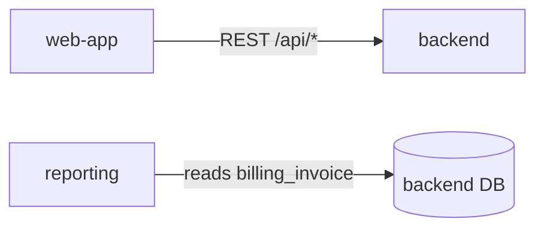

# Repo Map

One file that answers "where does this live and who depends on it". `ask-imogen`, `impact-analysis`, `prd-writer`, `jira-tickets` and `cross-repo-change` all read it, so keep it accurate and terse.

## Where it lives

- Multiple repos cloned side by side (the usual case): `repo-map.md` in the parent folder that holds them. Also commit a copy to `docs/repo-map.md` in the main backend repo so the team shares one version.
- Single repo: `docs/repo-map.md`.

## Build mode (no map yet)

1. **List the repos.** Every git repo in the workspace folder. Ask the dev if any client repos aren't cloned locally, and note them as "not cloned" rather than guessing.
2. **For each repo**, read: README, dependency file (`requirements*.txt`, `pyproject.toml`, `package.json`), `settings*.py`, root `urls.py`, `docker-compose*.yml`, CI config, `Procfile`/deploy config. Then for Django repos:
   - `INSTALLED_APPS` (local ones only) and, per app, its models in one line each.
   - URL prefixes per app (`path("api/billing/", include(...))`).
   - Celery tasks and beat schedule, management commands that run on cron.
   - Outbound calls to other services (`requests`, `httpx`, SDK clients) and which env var holds the base URL.
3. **Connections.** Who calls whom, over what: HTTP endpoint, shared database, queue, webhook, shared package. Shared DB tables are the most dangerous link; call them out.
4. **Conventions ("how we do X here").** Read 2-3 representative apps and write down the actual patterns, with one example file each:
   - Views (ViewSets vs APIView vs function views), routers, URL naming
   - Permissions and how querysets are scoped to the user/org
   - Where business logic lives (services module, model methods, serializers)
   - Serializer patterns, validation, error format
   - Tests: pytest vs unittest, factories vs fixtures, `conftest.py` helpers
   - Settings split and how env vars are read
   - Async work (Celery queues, `transaction.on_commit`)
5. **Write the map** with the template below. Keep it under ~300 lines; link to files instead of copying code.

~~~markdown
# Repo map
Last refreshed: YYYY-MM-DD (commit shas: backend abc123, web-app def456)

## Repos
| Repo | What it is | Stack | Deploys to | Run locally |
| --- | --- | --- | --- | --- |

## backend
Owns: billing, accounts, notifications
| App | Owns (models) | API prefix | Notes |
| --- | --- | --- | --- |
| billing | Invoice, Payment, Plan | /api/billing/ | Stripe webhooks in webhooks.py |
Background jobs: ...
Calls out to: ...

## <next repo> ...

## Connections

| From | To | How | Contract lives in |
| --- | --- | --- | --- |

## How we do X here
### Permissions
...example: billing/views.py:40
~~~

## Refresh mode (map exists)

1. Read the "Last refreshed" shas. For each repo, `git log --oneline <sha>..HEAD --stat` to see what changed since.
2. Only re-read areas touched by those commits: new apps, new models, URL changes, new outbound calls, new tasks.
3. Update the sections that changed, bump the date and shas, and list what changed at the top of your reply.

## Rules

- Everything in the map must be checkable: point to a file. No guesses dressed as facts; mark unknowns `(unverified)`.
- Don't include secrets, hostnames of production DBs, or credentials, even if they're in a settings file. Name the env var instead.
- Prefer the code over the README when they disagree, and note the disagreement.
