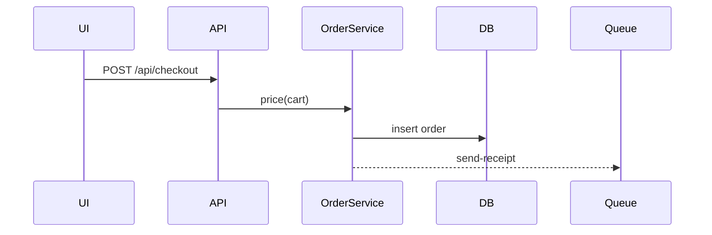

# Explain Code

Trace the real path through the code and explain it with citations. Every claim points at a file and line the asker can open.

## Step 0: Read the stack

1. Detect the stack from manifests (package.json, pyproject.toml, go.mod, Cargo.toml, Gemfile, composer.json, pom.xml / build.gradle, *.csproj) so you know where entry points live: routes, controllers, handlers, CLI commands, jobs, event listeners.
2. Read `repo-map.md` (parent folder of the repo) or `docs/repo-map.md` if present. Verify anything you use from it against the code.

## Step 1: Pin the question and the asker

- What exactly: a function, a file, a user action ("submit checkout"), a value ("where does `discount_total` come from").
- Who is asking and how deep: new to the codebase, reviewer, or the person about to change it. Ask if unclear; default to "dev about to change it".

## Step 2: Trace it

Start at the entry point and follow the call path for real. Do not guess from names.

1. Entry: the route, handler, CLI command, cron/job, or UI event. Find it with grep on the URL, command name, or event name.
2. Call path: each hop in order. Note middleware, decorators, interceptors, hooks and dependency injection, since these run without being called by name.
3. Data: what is read (DB tables, cache keys, config, env vars, request fields) and what is written.
4. Side effects: emails, queued jobs, events published, external API calls, files written, cache invalidation.
5. Branches: the conditions that change the path (feature flags, roles, error handling).

If a hop is dynamic (reflection, string dispatch, plugin registry, signals), say so and show how you resolved it, or say you could not.

## Step 3: Explain it

Shape the answer like this:

```
Short answer: Checkout total is computed server-side in OrderService.price(); the UI only displays it.

Path
1. POST /api/checkout -> routes/checkout.ts:12
2. auth + rate limit middleware -> middleware/index.ts:30
3. CheckoutController.create -> controllers/checkout.ts:45
4. OrderService.price(cart) -> services/order.ts:88  (applies coupons, then tax)
5. writes orders, order_items; enqueues send-receipt job -> services/order.ts:131

Watch out
- Tax is rounded per line, not per order (services/tax.ts:22).
```

Add a mermaid sequence diagram only when there are 3+ actors or async hops:



Depth by asker: new dev gets the short answer, the path, and where to read next. A dev about to change it also gets the side effects, the branches and the gotchas. A reviewer gets what is surprising.

## Rules

- Cite `file:line` for every step. If you did not open it, do not cite it.
- Separate what the code does from what it looks like it is meant to do. Flag likely bugs, do not fix them here.
- Do not dump whole files. Quote a line or two only when the exact text matters.
- Say what you did not trace (other branches, other services) so the asker knows the limits.

Next: `impact-analysis` before changing it, `characterization-tests` if it has no tests, or `onboarding` for a broader tour.
