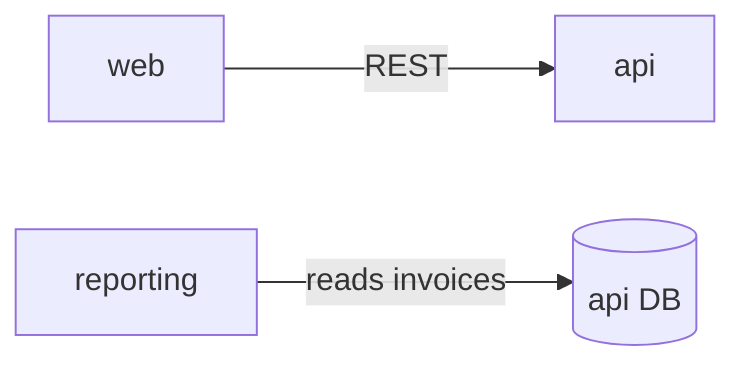

# Repo Map

One file that answers "where does this live and who depends on it". `ask-imogen`, `impact-analysis`, `prd-writer`, `jira-tickets`, `onboarding` and `cross-repo-change` read it, so keep it accurate and short.

## Where it lives

- Several repos cloned side by side (the usual case): `repo-map.md` in the parent folder. Commit a copy to `docs/repo-map.md` in the main repo so the team shares one version.
- Single repo: `docs/repo-map.md`.

## Build mode (no map yet)

1. **List the repos.** Every git repo in the workspace folder (`ls -d */.git`). Ask whether any repos aren't cloned locally; list them as "not cloned" instead of guessing.
2. **Read the stack, per repo.** Manifests and lockfiles (`package.json` + lockfile, `pyproject.toml`, `go.mod`, `Cargo.toml`, `Gemfile`, `pom.xml`, `*.csproj`, ...), README, `Makefile` or package scripts, `docker-compose*.yml`, `Dockerfile`, CI config, deploy config (`Procfile`, `fly.toml`, k8s/helm, `vercel.json`, terraform). In a monorepo, list the workspaces and give each app its own entry.
3. **Per repo, find:**
   - Entry points: server main, CLI, workers, scheduled functions.
   - Modules: top-level folders or packages and what each owns, one line each.
   - Data models: schema or model files (`schema.prisma`, ORM models, entities, `migrations/`, `*.sql`) and which database each talks to.
   - APIs exposed: route files, controllers, OpenAPI/GraphQL/proto files. Record prefixes and the spec file, not every endpoint.
   - APIs consumed: HTTP clients, SDKs, gRPC stubs, and the env var that holds each base URL.
   - Events: queues, topics and webhooks it produces or consumes.
   - Jobs: cron entries, scheduler config, queue workers, and their schedules.
4. **Connections.** Who calls whom and how: HTTP, shared database, queue, webhook, shared package. Shared DB tables are the riskiest link; call each one out.
5. **Conventions ("how we do X here").** Read 2-3 representative modules and write down the patterns actually used, each with one example file: routing and request handling, auth and permission checks, where business logic lives, data access (ORM, repositories, raw SQL), validation and error format, tests (runner, fixtures or factories, shared helpers), config and env vars, async work, logging.
6. **Write the map** with the template below, under ~300 lines. Link to files instead of copying code.

~~~markdown
# Repo map
Last refreshed: YYYY-MM-DD (commits: api abc123, web def456)

## Repos
| Repo | What it is | Stack | Deploys to | Run locally |
| --- | --- | --- | --- | --- |
| api | REST backend | Node 20, Fastify, Prisma, Postgres | Fly.io | `pnpm dev` |

## api
| Module | Owns (data) | Exposes | Notes |
| --- | --- | --- | --- |
| billing | Invoice, Payment | /billing/* (openapi.yaml) | Stripe webhooks in billing/webhooks.ts |
Jobs: nightly-export (cron 02:00, src/jobs/nightly-export.ts)
Calls out to: Stripe (STRIPE_API_KEY), notifications (NOTIFY_URL)

## Connections

| From | To | How | Contract lives in |
| --- | --- | --- | --- |

## How we do X here
### Permissions
... example: api/src/billing/routes.ts:40
~~~

## Refresh mode (map exists)

1. Read the "Last refreshed" commits. Per repo: `git log --oneline <sha>..HEAD --stat`.
2. Re-read only what those commits touched: new modules, schema or migrations, route files, outbound clients, jobs, events, manifests.
3. Update those sections, bump the date and commits, and list what changed at the top of your reply.

## Rules

- Everything in the map points to a file. Mark unknowns `(unverified)` instead of guessing.
- No secrets, credentials or production hostnames, even if a config file has them. Name the env var instead.
- When the README and the code disagree, the code wins; note the disagreement.
- Short beats complete. If a section grows past a screen, link to the file that holds the detail.

Next: `onboarding` for a new dev, or `impact-analysis` for the change that prompted the map.
